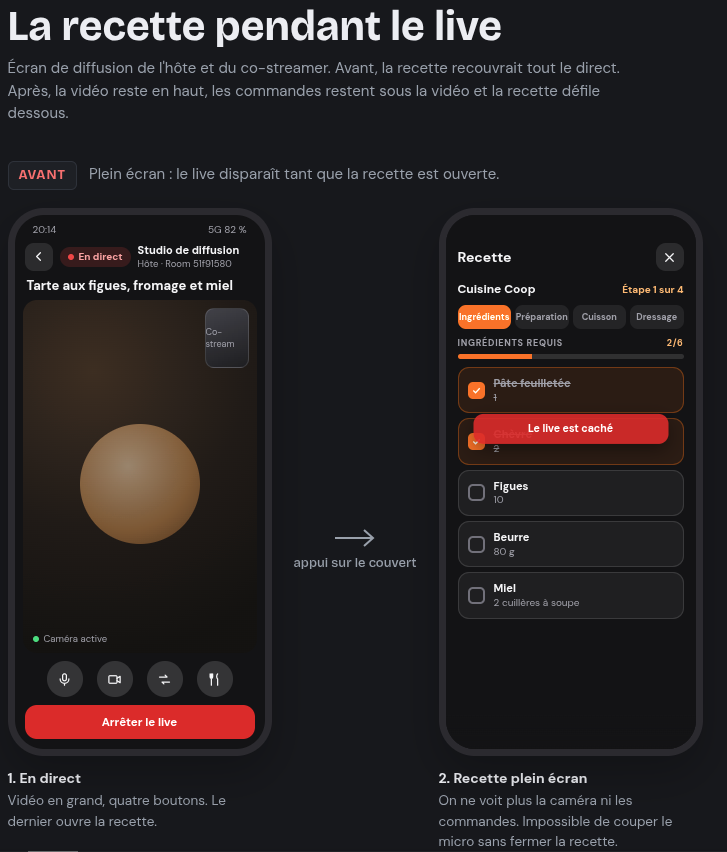
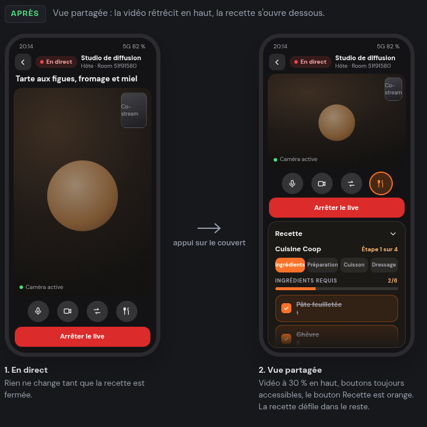

# Maquettes

## Recette pendant le live (écran de diffusion)

`recipe-split-view.html` : maquette interactive (à ouvrir dans un navigateur) de l'écran de diffusion de l'hôte et du co-streamer, avant et après.

| Avant : recette plein écran | Après : vue partagée |
|---|---|
|  |  |

- **Avant** : la recette recouvre tout le direct, les commandes sont cachées.
- **Après** : la vidéo rétrécit à 30 % en haut, les commandes restent dessous, la recette défile dans le reste. Le bouton Recette est mis en évidence tant qu'elle est ouverte.
